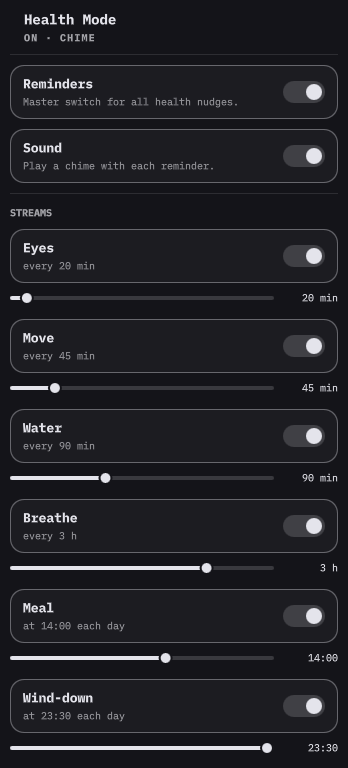

# omarchy-health-mode

Break reminders for the [Omarchy](https://github.com/basecamp/omarchy) shell bar.
A heart-pulse widget that nudges you to rest your eyes, move, drink water,
breathe, eat, and wind down — with a native settings popout, so no cadence ever
needs a terminal.

Self-contained: the reminder engine ships inside the plugin and the widget owns
its own once-a-minute heartbeat. No systemd units, no external binaries.



## Install

```sh
omarchy plugin add https://github.com/musgandapur645-sudo/omarchy-health-mode --enable
```

Then click the heart in the bar. Manual install: clone this repo into
`~/.config/omarchy/plugins/never.health` and run
`omarchy plugin enable never.health`.

## Use

- Click the heart to open settings.
- **Reminders** and **Sound** are the master switches; each stream has its own
  toggle and cadence slider (minutes for intervals, time-of-day for Meal and
  Wind-down).
- The glyph reflects state: heart-pulse (on) · dimmed (silent) · slashed heart
  (off). Hover shows the next nudge.
- Reminders pause while the session is idle or locked (details below).

## Eye exercise (optional)

An extra stream for a prescribed eye-exercise routine, such as the kind an
eye-care professional may assign for convergence treatment. Health Mode only
sends the reminder — it does not teach or prescribe any exercise; how to do the
exercise and how often is up to you and your eye-care professional.

- It is separate from the regular Eyes break reminder and is **off by default**.
- When enabled it nudges every five hours (interval adjustable) with the
  message: *"Do your 5-minute eye push-up exercise."*
- Enable it in the settings panel, or from the CLI for a personal setup:

```sh
bash bin/health-mode set streams.eyeexercise.enabled true
```

## Configuration

Kept outside the plugin so `omarchy plugin update` never touches it:

- `~/.config/health/config.json` — `reminders`, `sound`, and per-stream
  `enabled` / `every` / `at`
- `~/.local/state/health/state.json` — runtime (`last`, `firedToday`)

Both are created with defaults on first run. Default cadences: eyes 20 min,
move 45 min, water 90 min, breathe 3 h, meal 14:00, wind-down 23:30,
eye exercise off (5 h when on).

The bundled engine is a plain CLI too:

```sh
bash bin/health-mode summary            # JSON: mode, streams, next reminder
bash bin/health-mode tick               # fire anything due (the heartbeat)
bash bin/health-mode set streams.eye.every 25
bash bin/health-mode fire water         # force one nudge (preview)
```

## Requirements

Omarchy, and the tools its shell already ships: `jq`, `omarchy-notification-send`,
`paplay`, and a Nerd Font in the bar (the Omarchy default).

## Uninstall

```sh
omarchy plugin remove never.health
rm -rf ~/.config/health ~/.local/state/health
```

## Notes

- The heartbeat runs only while the shell runs; a missed tick costs at most a
  minute, and `state.json` resumes the schedule on the next one.
- **Idle and lock:** while the session is idle or locked nothing is sent, and a
  clock reminder (Meal, Wind-down) due during that time is *not* counted as
  delivered. When you return the same local day, a clock reminder that came due
  while you were away fires once; one that came due on an earlier day stays
  behind. Interval reminders never queue up: while you are away an overdue
  timer is reset silently, so on return the countdown starts fresh from that
  moment instead of bursting overdue nudges.
- With Omarchy "stay awake" enabled, idle suppression stops working, because
  that mode disables the shell's idle monitor.

## License

MIT — see [LICENSE](LICENSE).
